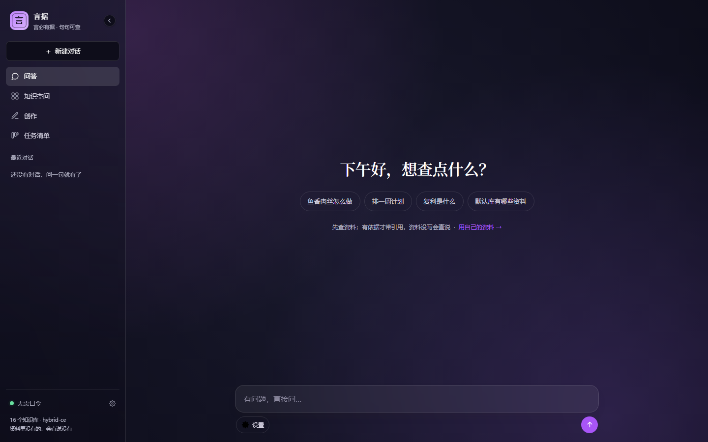
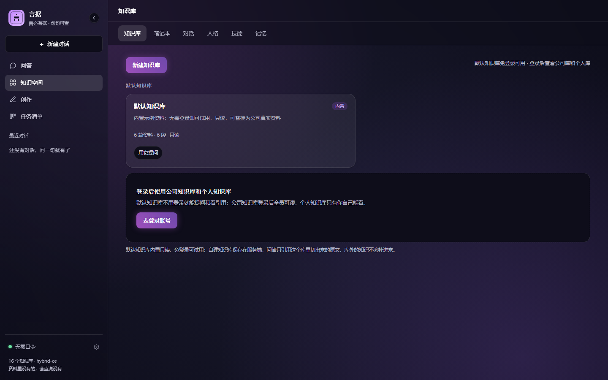
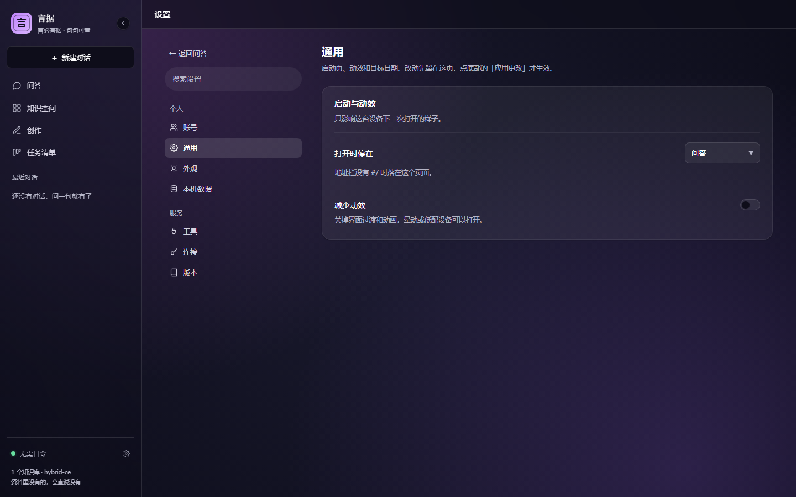
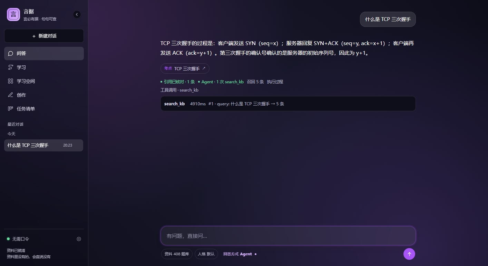

# 言据 · 可引用知识库与创作工具

[](https://github.com/gaozhe114514/yanju-rag/actions/workflows/tests.yml)

> 问资料，答得出来就带逐字引用，答不出来就明说；也能把主题整理成 Word 文档或 PPT。

**当前版本 v0.76.2** ｜ 667 条测试通过 ｜ 已部署到 `101.42.26.64`（线上 v0.76.2）｜ Python 3.11 · FastAPI · LangGraph · PostgreSQL 16 + pgvector · 单文件前端，无构建步骤



## 它是什么

一个「先查资料、再回答」的知识库应用。资料来自内置的 408 真题与考点、自建的讲义与笔记，也可以换成任何你贴进去的文档。回答必须逐字命中原文才算数；资料没覆盖的问题直接说没覆盖，并把缺口记下来，不编答案。

内置一份 408 知识笔记与真题库作演示语料，但产品本身不预设用户身份——课程、工作、生活话题都走同一套规则。

## 核心能力

| 能力 | 说明 |
|---|---|
| 可引用问答 | 问题理解 → BM25 + 向量召回 → RRF → Cross-Encoder 精排 → 拒答闸门 → 生成 → 引用逐字校验；校验不过重试一次，仍不过就拒答 |
| Agent 层（v0.76） | LangGraph 状态图：规划 → 调用 `search_kb` → 拒答判断 → 生成 → 逐字校验 → 换查询重试一次 → 拒答；工具调用与执行过程可见，线程记忆可落 PostgreSQL |
| 自建知识库 | PDF / Word / PPT / Excel / Markdown / TXT / HTML 与图片 OCR；切分成可引用片段，支持在线编辑、附件、表格与原文高亮 |
| 学习闭环 | 精通之路（导师定大纲、出题、按证据判掌握）、练习、错题本、10 题小测、知识图谱 |
| 创作 | 选文档或演示文稿，写主题 → 确认大纲 → 下载 Word `.docx` / PPT `.pptx` / Markdown `.md` |
| 账号与权限 | 注册登录、管理员管账号、个人内容跨设备同步；知识库分内置 / 公司 / 个人三层，服务端逐入口判权 |
| 界面 | 琉璃 / 雪白 / 奶油 / 深色四套主题（琉璃默认），桌面与手机同一套页面 |

| 知识库：31 篇资料、1683 段可引用片段 | 设置：四套主题，琉璃为默认 |
|---|---|
|  |  |

## Agent 层

输入条把 **回答方式** 切成 **Agent** 后，回答不只给出引用，还能看到完整轨迹：理解问题 → 调用 `search_kb` 检索 → 拒答判断 → 生成 → 逐字校验；校验不过会换一个检索问题重试一次，仍不过就拒答。工具参数、命中条数与每步耗时都能在回答下展开。



资料范围由输入条的「资料」胶囊单独选择；「回答方式」只决定标准问答还是 Agent 编排，两者共用同一个知识库，不是两套数据。

- **不动检索**：`search_kb` 仍调用原来的 BM25 + 向量 → RRF → Cross-Encoder，只把返回的 top 片段暴露成工具。
- **硬约束不变**：引用仍逐字命中原文；失败重试一次后拒答；资料不足写缺口日志。
- **线程记忆**：默认进程内，配 `DATABASE_URL` 后自动切到 PostgreSQL checkpoint；换账号拿旧线程号会新建线程。
- **接口**：`POST /agent/stream`（SSE）；现有 `/chat`、`/chat/stream` 完全不动。

细节与取舍见 [Agent 层](docs/Agent层.md)。

## 系统架构


- **离线数据管线**：真题 → 切题 → 抽取 → 机器校验 → 人工校对 → 定稿 JSONL。
- **检索与存储**：JSONL 是构建产物与语料种子；线上由 PostgreSQL + pgvector 承载题目、考点、用户资料与向量，BM25 留在应用进程。
- **在线链路**：检索 → 拒答闸门 → 生成（强制 JSON）→ 引用逐字校验 → 失败重试 → 仍失败拒答；资料不足时改给标明的通用回答，并写缺口日志。
- **前端**：`web/index.html` 单文件，hash 路由，流式输出，无构建步骤。

更细的选型与取舍见 [架构设计](docs/架构设计.md)，带源码出处的全链路流程图见 [流程图.html](docs/流程图.html)。

## 快速开始

### Docker（含 PostgreSQL）

```bash
cp .env.example .env          # 填 DEEPSEEK_API_KEY / KB_ACCESS_TOKEN / POSTGRES_PASSWORD
mkdir -p logs && sudo chown -R 1000:1000 logs
docker compose up -d --build  # 首次 10~30 分钟，含 2.4GB 模型
curl -s http://127.0.0.1:8000/health
```

### 本地 mock（不需要 API key）

```bash
py -3.11 -m uvicorn api.app:app --host 127.0.0.1 --port 8000
# 浏览器打开 http://127.0.0.1:8000
```

mock provider 只取 top-1 的答案，用来验证链路，不是真生成。

### 离线跑一遍数据管线

```bash
py -3.11 -m pipeline.build --paper data/raw/sample_paper.txt \
                          --answer data/raw/sample_answer.txt \
                          --year 2024 --provider mock
```

> 项目按 Python 3.11 维护；Windows 上用 `py -3.11`（或先激活 3.11 的虚拟环境），不要用 Microsoft Store 的 `python` 占位符。

### 运行测试

```bash
py -3.11 -m unittest discover -s tests -t . -v
```

## 文档

| 文档 | 内容 |
|---|---|
| [设计规范](design.md) | 配色、字体、间距、组件与布局的唯一来源；改界面前先读 |
| [架构设计](docs/架构设计.md) | 在线链路、分层架构、数据模型、选型理由、成本与落地顺序 |
| [功能说明](docs/功能说明.md) | 产品框架、自建知识库、权限、文件进料、账号同步、WeKnora |
| [Agent 层](docs/Agent层.md) | LangGraph 状态图、search_kb、线程记忆、SSE 事件与边界 |
| [在线问答与接口](docs/接口.md) | 启动方式、HTTP 接口一览、访问口令、限流与缓存 |
| [检索与评测](docs/检索与评测.md) | 检索模式、2019 卷基线、拒答阈值标定、真实生成评测 |
| [存储层](docs/存储层.md) | PostgreSQL + pgvector 的表结构、语料同步与重建 |
| [语料说明](docs/语料说明.md) | 五卷真题、答案与解析的来源与草稿状态 |
| [数据管线](docs/数据管线.md) | 真题 → 结构化题库的五步流程与验收门槛 |
| [部署](docs/部署.md) | 云服务器 ECS 上的 Docker + Nginx + 口令 + 限流，含部署记录 |
| [更新记录](docs/更新记录.md) | 从 v0.24 至今每个版本改了什么、怎么验证的 |
| [全链路流程图](docs/流程图.html) | 离线建库 → 在线问答 → 前端页面；单文件 HTML，浏览器直接打开 |

参考资料：[WeKnora 接入](docs/WeKnora接入.md)、[精通之路与 DeepTutor 对照](docs/精通之路-DeepTutor对照.md)、[借鉴 WeKnora 的改造方案](docs/借鉴WeKnora-改造方案.md)。

## 目录结构

```
data/
  raw/       原始输入（试卷 txt + 答案 txt）
  curated/   人工整理 / 模型补全的考点、解析与 408 笔记
  eval/      检索评测 query 集
  out/       定稿 JSONL
  work/      中间产物（已 gitignore）
agent/       Agent 状态图、search_kb 工具、线程记忆与运行时
pipeline/    离线数据管线：切题、抽取、校验、校对、补解析
retrieval/   chunk、bigram 分词、BM25、bge 向量、RRF、Cross-Encoder、评测
answer/      问题理解、拒答闸门、生成、引用校验、流式、用资料出题、文档与 PPT
api/         FastAPI 服务、账号与权限、题库 / 考点 / 图谱、质量看板
kb/          用户资料切分、文件解析、表格结构化、知识库管理
db/          PostgreSQL 表结构与语料同步
web/         单文件前端 web/index.html
deploy/      nginx 配置
tests/       标准库 unittest
docs/        架构、功能、接口、评测、部署、更新记录与配图
tools/       构建期预下载模型
```

逐文件说明见 [目录结构](docs/目录结构.md)。

## 硬约束

- **一道题 = 一个 chunk**：题干、选项、答案解析、图永远不拆开。
- **一张考点卡片 = 一个 chunk**：正文写成可直接引用的完整句子；卡片标明 `source: self`，不冒充教材原文。
- **E 级校验错误不归零，不许进检索库。**
- **公式原样保留**，不让模型重写 LaTeX。
- **引用必须逐字命中原文**：校验不过重试一次，仍不过就拒答。
- **Agent 与主链路同一套规则**：`/agent/stream` 也必须逐字校验；失败最多换查询重试一次，仍失败必须拒答。
- **拒答优于硬编**：资料未覆盖时明说，并记录缺口日志。

## 版权

仅使用公开流传的真题原文，解析自行整理；不搬运机构付费资料。定位为个人学习交流，如涉版权问题请联系下架。
